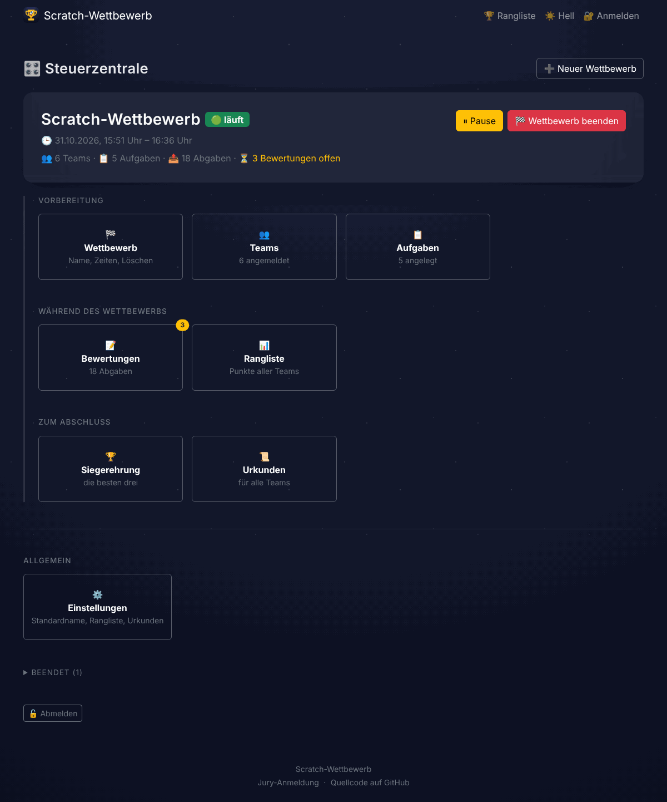
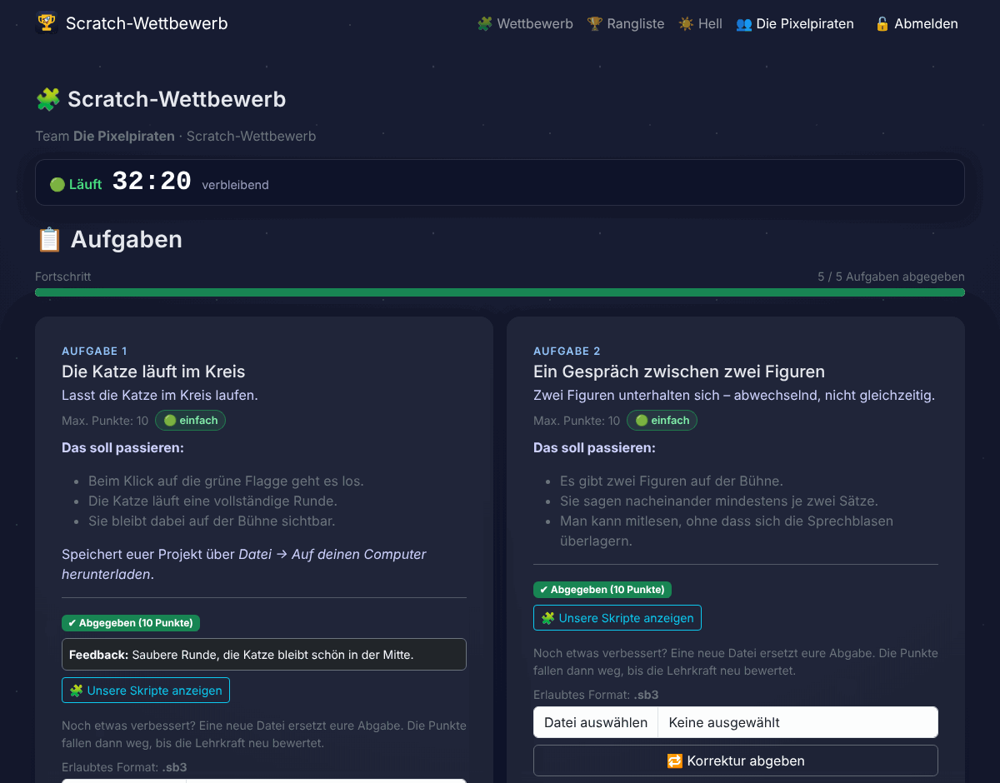
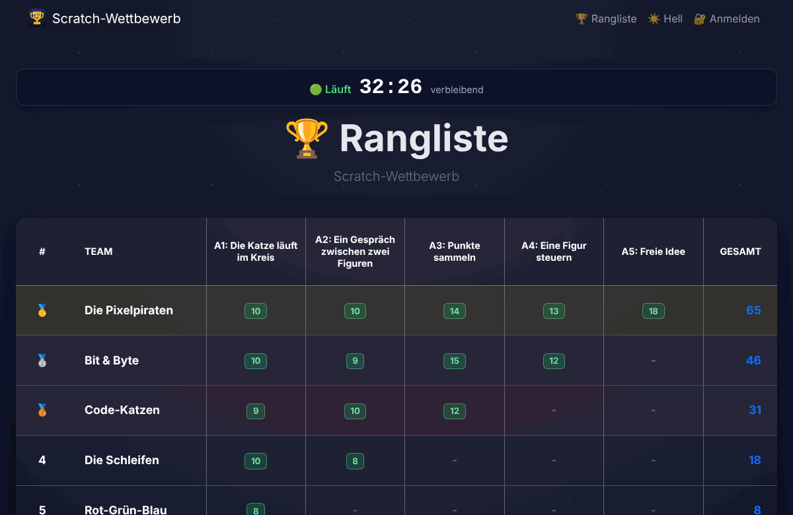
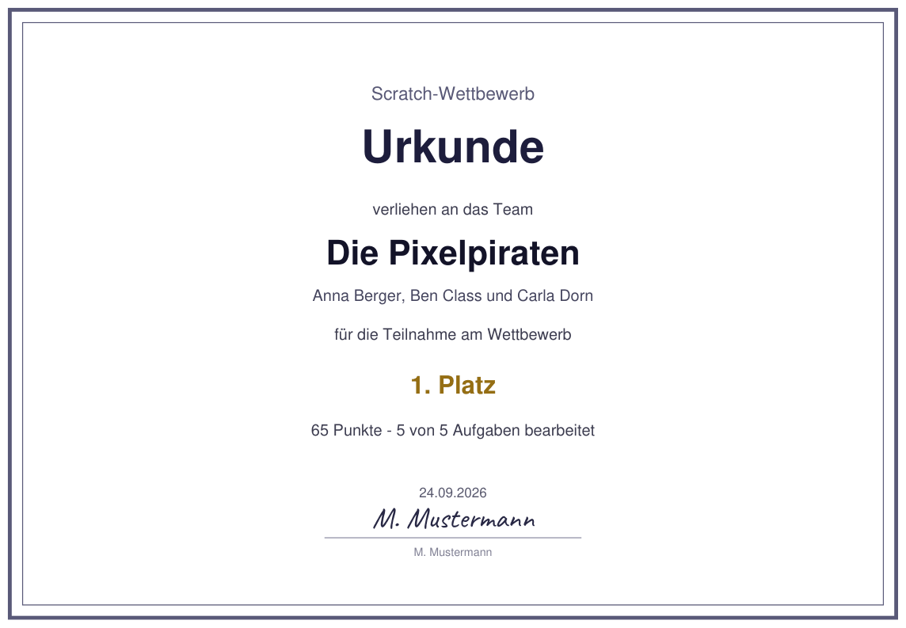

# 🚀 Coding-Wettbewerb-Plattform

Eine Flask-basierte Webanwendung für Coding-Challenges, Hackathons und Programmier-Wettbewerbe an Schulen — läuft komplett lokal im eigenen Netzwerk, **ganz ohne Internetzugriff**.


[](https://github.com/Obi-Wahn/challenge_plattform/actions/workflows/tests.yml)


## ⚡ Schnellstart

1.  [Python 3.11 oder höher](https://www.python.org/downloads/) installieren.
2.  Das Projekt als ZIP von der
    [Release-Seite](https://github.com/Obi-Wahn/challenge_plattform/releases)
    herunterladen und entpacken.
3.  Die Startdatei für das eigene System öffnen: `start_windows.bat`,
    `start_macos.command` oder `start_linux.sh`. Sie richtet beim ersten Mal
    alles ein (dafür braucht es einmal Internet) und startet die Plattform.

Ausführlich, auch für die Installation mit git und von Hand:
[Installation & Setup](#-installation--setup).
Für den Wettbewerbstag selbst: [Leitfaden](#-leitfaden-für-den-wettbewerbstag).

## 📑 Inhalt

- [Schnellstart](#-schnellstart)
- [So sieht es aus](#-so-sieht-es-aus)
- [Features](#-features)
- [Technologien](#-technologien)
- [Installation & Setup](#-installation--setup)
- [Leitfaden für den Wettbewerbstag](#-leitfaden-für-den-wettbewerbstag)
- [Daten und Sicherungen](#-daten-und-sicherungen)
- [Protokolldatei](#-protokolldatei)
- [Entwicklung](#-entwicklung)
- [Herkunft & Mitwirkende](#-herkunft--mitwirkende)
- [Lizenz](#-lizenz)

## 📸 So sieht es aus

| Steuerzentrale (Lehrkraft) | Teamansicht (Schülerinnen und Schüler) |
| --- | --- |
|  |  |

| Rangliste | Urkunde |
| --- | --- |
|  |  |

## 🌟 Features

### Für die Teams
*   **Beitritt per QR-Code** oder über die abgetippte Adresse, auf Desktop, Tablet und Smartphone.
*   **Registrierung je Wettbewerb** mit Teamname und Passwort. Ist der Wettbewerb beendet oder pausiert oder keiner aktiv, nimmt die Startseite keine neuen Teams an.
*   **Wettbewerbsseite**: alle Aufgaben durchnummeriert wie in der Rangliste, mit Schwierigkeit (🟢 einfach, 🟡 mittel, 🔴 schwer), Punkten, Feedback und der Restzeit als Leiste.
*   **Aktualisiert sich selbst** alle 15 Sekunden: Pause, Hinweise, Durchsagen und neue Zeiten kommen ohne Neuladen an.
*   **Abgabe je Aufgabe**: Processing (`.pde`), Scratch (`.sb`/`.sb3`), Python (`.py`), Java (`.java`), MakeCode/Calliope (`.hex`/`.mkcd`), Open Roberta und Snap! (`.xml`), Arduino (`.ino`), App Inventor (`.aia`), Jupyter (`.ipynb`) — das Format legt die Aufgabe fest.
*   **Eigene Skripte ansehen**: Scratch-, Snap!- und MakeCode-Abgaben als Blöcke, jedes Team nur seine eigene.
*   **Hinweise**, die die Lehrkraft freischaltet, wenn ein Team nicht weiterkommt.
*   **Korrektur**: Solange der Wettbewerb läuft, ersetzt ein Team seine Abgabe selbst; je Wettbewerb abschaltbar.
*   **Namen für die Urkunde** trägt das Team selbst ein, auf die Urkunde kommen sie nach der Freigabe.
*   **Eigene Urkunde als PDF** nach dem Ende zum Herunterladen.

### Für die Lehrkraft
*   **Steuerzentrale**: Zustand, Teams, Aufgaben und offene Bewertungen auf einen Blick, geordnet nach Vorbereitung, Wettbewerb und Abschluss.
*   **Wettbewerbe verwalten**: anlegen, aktivieren, pausieren, beenden, wieder öffnen und löschen; beim Anlegen lassen sich die Teams eines früheren Wettbewerbs übernehmen.
*   **Eigener Name je Wettbewerb**, mit Untertitel und Gruß auf der Startseite, auf allen Seiten und Urkunden, auch wenn längst ein anderer läuft.
*   **Aufgaben** in Markdown mit Dateiformat, Schwierigkeit und Hinweis, sortierbar mit ▲ und ▼, als JSON zu sichern und wieder einzulesen; fertige Sätze für Scratch, Snap! und Calliope liegen unter `beispiele/`.
*   **Wettbewerb sichern** als ZIP und als neuen Wettbewerb wieder einlesen, auch auf einem anderen Rechner; Namen und Passwörter nur auf Wunsch. Ein Beispiel-Wettbewerb liegt unter `beispiele/`.
*   **Aufräumen**: Nach dem Ende löscht ein Knopf alle Teams und Abgaben; Protokolldatei und alte Sicherungskopien lassen sich unter Einstellungen löschen.
*   **Zeit im Griff**: Start- und Endzeit oder eine Dauer, „Jetzt starten für … Minuten“; die Pause hält die Uhr an.
*   **Durchsagen** an alle Teams und über der Rangliste, je Wettbewerb einschaltbar.
*   **Bewerten**: nach Aufgaben geordnet, offene zuerst, Scratch-, Snap!- und MakeCode-Skripte als Blöcke, Textformate im Browser, Download, Punkte und Feedback.
*   **Bewertungszugang**: ein eigenes Passwort für Helfende, das nur die Bewertungsseite des aktiven Wettbewerbs öffnet.
*   **Teams**: Passwort zurücksetzen, Namen für die Urkunde kontrollieren und freigeben.
*   **Urkunden** als PDF, quer oder hoch, mit Unterschrift in Handschrift, auch für einen längst beendeten Wettbewerb.
*   **Einstellungen**: Standardname, Rangliste, Urkundenformat, Namen der Teammitglieder, Unterschrift, Bewertungszugang.
*   **Protokolldatei**: Was angelegt, geändert oder gelöscht wird, steht in `logs/anwendung.log`, dazu jede abgewiesene Abgabe mit Grund.
*   **Eigene Fehlerseiten** auf Deutsch mit einem Weg zurück.

### Für den großen Bildschirm (Display, Smartboard oder Beamer)
*   **Startseite** mit Gruß, Adresse zum Abtippen und QR-Code, ohne Scrollen.
*   **Rangliste** mit Punkten je Aufgabe, „A1: Titel“ über den Spalten und der Restzeit, lädt sich alle 30 Sekunden neu; nach dem Ende führt sie zum Siegerpodest.
*   **Rangliste einfrieren** ab einstellbaren Minuten vor Schluss, je Wettbewerb; jedes Team sieht seine eigenen Punkte weiter aktuell.
*   **Hell oder dunkel** wie das Gerät, umschaltbar in der Leiste; die Wahl merkt sich nur der Browser.
*   **Siegerehrung**: Podest der besten drei, Platz für Platz aufgedeckt; Gleichstände teilen sich einen Platz.

### Ohne Installationsaufwand
*   **Startdateien** für Windows, macOS und Linux richten beim ersten Öffnen alles ein und starten die Plattform.
*   **Version beim Start**: Die Übersicht nennt, welcher Stand läuft, bei einem ZIP genauso wie bei git.
*   **Läuft im Schul-LAN, ganz ohne Internet**; Port und angezeigte Netzwerkadresse lassen sich in der `.env` setzen.

## 🛠 Technologien

*   **Backend**: Python, Flask, SQLAlchemy (SQLite), waitress (Produktiv-WSGI-Server).
*   **Frontend**: HTML5, CSS3, Bootstrap 5, Markdown-Editor (EasyMDE), scratchblocks für die Skripte der Scratch-, Snap!- und MakeCode-Abgaben — alle Assets liegen lokal im Repo (`static/vendor/`), keine CDN-Abhängigkeit, funktioniert komplett offline.
*   **PDF**: fpdf2 für die Urkunden. Die Handschriften unter `static/vendor/fonts/` stehen
    unter der SIL Open Font License (Lizenztexte liegen daneben) und sind mit im Repo,
    damit die Urkunden auch ohne Internet entstehen. Für den übrigen Text nimmt das PDF
    die eingebaute Helvetica: Buchstaben mit fremden Akzenten verlieren ihn („Şükrü“
    wird „Sükrü“), Emoji und andere Schriften fallen weg. Die Seite *Urkunden* nennt die
    betroffenen Namen.
*   **MakeCode**: Texte, Farben und LED-Symbole der Calliope-Blöcke stammen aus
    [MakeCode Calliope](https://github.com/microsoft/pxt-calliope) (MIT-Lizenz) und liegen
    als `plattform/makecode_bloecke.json` im Repo.
*   **Sicherheit**:
    *   Passwort-Hashing (Werkzeug Security).
    *   CSRF Protection (Flask-WTF).
    *   Rate-Limiting auf den Anmeldeseiten (Flask-Limiter).
    *   Secure Filename Handling.
    *   Kein Debug-Modus im Normalbetrieb (nur über `FLASK_DEBUG=true` für lokale Entwicklung).
    *   Unverschlüsselt: Die Plattform spricht http, nicht https. Im selben Netz lässt sich mitlesen. Das Admin-Passwort deshalb nirgends sonst verwenden und die Steuerzentrale möglichst am Server selbst bedienen.
*   **Architektur**: Modularer Aufbau mit Flask Blueprints und Application Factory Pattern.

## 🚀 Installation & Setup

Voraussetzung: Python 3.11 oder höher (Markdown, das die Aufgabentexte darstellt, verlangt diese Version).
Ubuntu 22.04 und Linux Mint 21 bringen noch Python 3.10 mit, dort reicht es nicht.
Unter Windows findet die Startdatei Python von selbst, ob es mit dem
Python install manager oder dem älteren Installationsprogramm von
[python.org](https://www.python.org/downloads/) kam.

### Der einfache Weg: Startdatei öffnen

1.  **Herunterladen** – entweder als ZIP von der
    [Release-Seite](https://github.com/Obi-Wahn/challenge_plattform/releases)
    und entpacken, oder mit git:
    ```bash
    git clone https://github.com/Obi-Wahn/challenge_plattform.git
    ```

2.  **Startdatei öffnen**

    | System | Datei | So geht's |
    |---|---|---|
    | Windows | `start_windows.bat` | doppelklicken |
    | macOS | `start_macos.command` | doppelklicken |
    | Linux | `start_linux.sh` | im Terminal `./start_linux.sh` |

Beim **ersten Start** richtet die Startdatei alles selbst ein: die virtuelle
Umgebung `.venv`, die Pakete (dafür braucht es einmal **Internet** – also
nicht erst am Wettbewerbstag im Schulnetz ausprobieren) und die `.env` mit
einem zufälligen `SECRET_KEY`. Das Admin-Passwort fragt sie einmal ab. Danach
startet die Plattform, und der Browser geht auf.

Bei **jedem weiteren Start** prüft sie nur, ob noch alles da ist, und startet
dann direkt. Fehlt etwas – ist etwa `.venv` gelöscht worden –, holt sie genau
das nach. Die Datenbank fasst sie nie an, eine vorhandene `.env` nur in einem
Fall: Steht darin noch ein Beispielwert aus `.env.example` oder `docs/ENTWICKLUNG.md`
oder ist der `SECRET_KEY` kürzer als 32 Zeichen, würfelt sie einen neuen
Schlüssel (die Teams melden sich danach einmal neu an) und fragt nach einem
eigenen Admin-Passwort. Mit einem bekannten Schlüssel könnte sich sonst jeder
ohne Passwort in die Steuerzentrale bringen.

Die Umgebung bleibt an das Python gebunden, mit dem sie angelegt wurde; die
Übersicht nennt es, etwa „Virtuelle Umgebung ..... vorhanden (Python 3.13)“.
Wer auf ein neueres Python wechseln will, löscht den Ordner `.venv` und öffnet
die Startdatei – dafür braucht es wieder einmal Internet. Wird das alte Python
deinstalliert, merkt die Startdatei das und legt die Umgebung selbst neu an.
Ebenso eine Umgebung mit Python 3.10 von vor der Anhebung auf 3.11: Die Pakete
ließen sich darin nicht mehr installieren.

**Beenden** mit STRG+C im Fenster.

```text
Coding-Wettbewerb-Plattform
===========================

Version ................ 1.23.1 (Stand 27.10.2026)
Python ................. 3.13.1
Virtuelle Umgebung ..... vorhanden (Python 3.13)
Pakete ................. aktuell
Konfiguration .......... vorhanden
Datenbank .............. vorhanden
```

Die erste Zeile sagt, **welche Fassung** hier liegt. Die Nummer kommt aus
dem Release, von Hand gepflegt wird sie nirgends: Bei git fragt die
Startdatei git, bei einem ZIP hat GitHub sie beim Packen in `stand.txt`
eingetragen. Enthält der Stand Änderungen nach dem letzten Release, steht
das dabei, etwa „1.23.1 + 3 Änderungen (Stand 30.10.2026)“. Steht dort
„unbekannt“ – etwa bei einem von Hand kopierten Ordner –, läuft die
Plattform trotzdem. Die Zeile steht auch im Protokoll.

**Wenn sich die Datei nicht öffnen lässt:**

*   **macOS** meldet bei einer heruntergeladenen Datei „nicht verifizierter
    Entwickler“: einmal mit Rechtsklick → *Öffnen* starten, bei neueren
    Fassungen unter *Systemeinstellungen → Datenschutz & Sicherheit →
    Dennoch öffnen*. Heißt es „keine Berechtigung“, hat das Entpacken das
    Ausführungsrecht verloren – im Terminal im Ordner
    `chmod +x start_macos.command` eingeben.
*   **Windows** warnt bei Dateien aus dem Internet mit „Der Computer wurde
    durch Windows geschützt“: *Weitere Informationen → Trotzdem ausführen*.
*   **Linux**: Ein Doppelklick öffnet die Datei je nach Oberfläche im Editor.
    Darum im Terminal starten; fehlt das Ausführungsrecht,
    `sh start_linux.sh`. Unter Debian und Ubuntu fehlt für die virtuelle
    Umgebung manchmal ein Paket: `sudo apt install python3-venv`.

Ohne Browserfenster: `./start_linux.sh --ohne-browser`. Für einen Rechner
ohne Bildschirm siehe den nächsten Abschnitt.

### Auf einem Rechner ohne Bildschirm (etwa Raspberry Pi)

Die Plattform läuft auch auf einem kleinen Linux-Rechner, der nur per SSH
erreichbar ist. Wie man ihn einrichtet, ihm eine feste Adresse gibt, die Uhrzeit
prüft und die Plattform als Dienst starten lässt, steht in
**[docs/RASPBERRY_PI.md](docs/RASPBERRY_PI.md)**.

### Aktualisieren

*   **Mit git geholt:** die Startdatei mit `--aktualisieren` aufrufen, also
    `./start_linux.sh --aktualisieren` bzw. `start_windows.bat --aktualisieren`
    in der Eingabeaufforderung. Sie holt die neue Fassung mit
    `git pull --ff-only`, ruft sich danach selbst in der neuen Fassung auf,
    installiert geänderte Pakete nach und startet.
    Sind Dateien der Plattform von Hand geändert worden, bricht sie ab,
    statt sie zu überschreiben. Was dann zu tun ist, steht im Leitfaden
    unter [Wenn etwas klemmt](docs/ADMIN_GUIDE.md#-wenn-etwas-klemmt).
*   **Als ZIP geholt:** Plattform beenden, das neue ZIP in einen **neuen**
    Ordner entpacken, aus dem alten `data/`, `uploads/` und `.env` hinüber-
    kopieren (`.env` ist oft versteckt, weil sie mit einem Punkt beginnt),
    Startdatei im neuen Ordner öffnen. `--aktualisieren` sagt dasselbe.

In beiden Fällen passt die Plattform die Datenbank beim Start selbst an,
siehe [Daten und Sicherungen](#-daten-und-sicherungen).

### Adresse und Port

Beim Start nennt die Plattform die Adresse, unter der sie erreichbar ist –
auf dem Rechner selbst `http://localhost:8000`, für die anderen Geräte im
selben Netz die Netzwerk-Adresse, die auch auf der Startseite und im
QR-Code steht.

Diese Netzwerk-Adresse erfragt die Anwendung beim Betriebssystem. In einem
Netz **ohne Gateway** — ein Switch, an dem nur die Rechner der Schule
hängen — lässt sich das so nicht beantworten. Die Anwendung sagt das dann
beim Start und nennt keine Adresse, statt eine zu nennen, die kein Gerät
erreicht. Abhilfe: die Adresse am Server ablesen (`ip addr` bzw.
`ipconfig`) und als `LAN_ADRESSE=192.168.1.50` in die `.env` eintragen.
Der Eintrag sticht die Erkennung und landet auf der Startseite und im
QR-Code.

Die Anwendung läuft auf Port **8000**. Belegt schon ein anderes Programm
auf dem Rechner diesen Port, startet sie nicht. Dann lässt sich der Port
mit `PORT=8002` in der `.env` ändern; die Startmeldung, die Startseite und
der QR-Code nennen danach den neuen Port.

### Von Hand, für Entwicklung

Wer am Code arbeitet, richtet die Plattform auch ohne Startdatei ein. Wie,
steht in **[docs/ENTWICKLUNG.md](docs/ENTWICKLUNG.md)**.

## 🧭 Leitfaden für den Wettbewerbstag

Der Weg hinein: `/admin` aufrufen – der Link steht auch in der Fußzeile jeder
Seite – und mit dem Passwort anmelden, das die Startdatei beim ersten Mal
abgefragt und als `ADMIN_PASSWORD` in die `.env` geschrieben hat. Den Namen,
unter dem die Teams ihren Wettbewerb sehen, trägt man beim Anlegen des
Wettbewerbs ein. Unter *Einstellungen* steht nur der Standardname für die
Zeit, in der kein Wettbewerb aktiv ist.

Wie ein Wettbewerb **abläuft** – was rechtzeitig vorher, am Vortag, während
des Wettbewerbs und danach zu tun ist, und was zu tun ist, wenn etwas klemmt –
steht in **[docs/ADMIN_GUIDE.md](docs/ADMIN_GUIDE.md)**.

## 💾 Daten und Sicherungen

Ein Wettbewerb steckt in **zwei** Verzeichnissen, und für eine Sicherung
braucht man beide:

| Verzeichnis | Inhalt |
|---|---|
| `data/` | die Datenbank `challenge.db`: Teams, Aufgaben, Punkte, Bewertungen |
| `uploads/` | die abgegebenen Dateien der Teams |

Die Datenbank merkt sich zu jeder Abgabe nur, **wo in `uploads/`** die Datei
liegt, nicht die Datei selbst und nicht den Ordner der Installation. Nach einem
Umzug in einen neuen Ordner oder auf einen anderen Rechner findet sie die
Dateien also wieder. Wer aber nur `data/` sichert, hat nach einem Ausfall zwar
die Punktestände, aber nicht die Programme, für die sie vergeben wurden. Beide
Verzeichnisse gehören **nicht** ins Repository und werden von `.gitignore`
ausgeschlossen.

Bringt eine neue Version der Anwendung eine Änderung an der Datenbankstruktur
mit, wird diese beim Start automatisch ergänzt. **Vor der ersten solchen
Änderung legt die Anwendung eine Kopie an**, zum Beispiel:

```
data/challenge-vor-teams-2026-09-20-1430.db
```

Beim Start steht dann eine Zeile wie „Datenbank vor der Änderung gesichert: …"
im Fenster. Die Kopie entsteht nur, wenn wirklich etwas geändert wird – bei
allen folgenden Starts passiert nichts mehr. Geht das Sichern schief (etwa
weil die Festplatte voll ist), bricht der Start ab, statt ungesichert
umzubauen.

**Wofür die Kopie gut ist:** Falls ein Umbau zwar durchläuft, aber nicht das
Gewünschte tut, kommt man damit an den Stand davor heran. Zum Rückgängigmachen
die aktuelle Datei zur Seite legen und die Kopie nach `data/challenge.db`
umbenennen. Alte Kopien löscht man, sobald klar ist, dass alles passt – unter
*Einstellungen* mit **🧹 Kopien löschen**. Sie enthalten alles, auch Namen und
Passwörter.

**Wofür sie nicht gut ist:** Sie ersetzt keine regelmäßige Sicherung. Sie liegt
im selben Ordner und enthält nur die Datenbank – geht die Festplatte kaputt
oder wird das Verzeichnis gelöscht, ist sie mit weg, und die abgegebenen
Dateien waren ohnehin nie darin. Vor einem echten Wettbewerb gehören deshalb
**`data/` und `uploads/`** auf einen USB-Stick.

### Einen einzelnen Wettbewerb sichern

Auf der Seite eines Wettbewerbs steht unten **💾 Wettbewerb sichern**. Der
Knopf lädt eine ZIP-Datei herunter:

| In der ZIP | Inhalt |
|---|---|
| `wettbewerb.json` | Name, Untertitel, Gruß, Zeiten, ob die Rangliste einfriert, ob Durchsagen eingeschaltet sind (ohne deren Text) und ob Teams selbst korrigieren dürfen, Aufgaben mit Hinweis und Schwierigkeit, Teams, Abgaben mit Punkten, Feedback und Zeitpunkt |
| `abgaben/team_<n>/` | die abgegebenen Dateien, je Team ein Ordner |

Eingelesen wird sie unter **➕ Neuer Wettbewerb → Oder aus einer Sicherung
einlesen**. Daraus entsteht immer ein **neuer, inaktiver** Wettbewerb; ein
vorhandener wird nie überschrieben. Rangliste und Urkunden gehen danach wie bei
jedem anderen Wettbewerb.

Mit Blick auf den Datenschutz ist die Datei so knapp wie möglich:

- **Die Namen der Teammitglieder nur auf Wunsch.** Das Häkchen dafür ist
  zunächst aus. Nötig ist es nur, wenn die Urkunden mit Namen später aus der
  Sicherung gedruckt werden sollen.
- **Die Passwörter der Teams nur auf Wunsch**, mit einem eigenen Häkchen, das
  ebenfalls zunächst aus ist. Nötig ist es nur, wenn der Wettbewerb auf einem
  anderen Rechner weiterlaufen soll: Dann melden sich die Teams dort mit ihrem
  alten Passwort an. Im Klartext kennt die Plattform die Passwörter nicht, in
  die Datei kommt nur ihr Hash. Aus dem lässt sich ein schwaches Passwort wie
  „1234“ aber mit etwas Rechenzeit zurückraten – ein Problem, sobald ein Kind
  dasselbe Passwort auch anderswo benutzt. Ohne das Häkchen haben die Teams
  nach dem Einlesen kein Passwort; für Rangliste und Urkunden braucht es
  keins. Zum Weitermachen den Wettbewerb aktivieren und unter **Teams** neue
  vergeben – die Teamseite zeigt nur den aktiven Wettbewerb.
- **Nie das Kennzeichen der Anmeldung.** Jedes eingelesene Team bekommt ein
  neues, eine Sitzung von der alten Installation gilt also nicht.
- **Keine Einstellungen der Installation** (Standardname, Unterschrift): Die
  gehören nicht zu einem Wettbewerb.

Mit Namen oder Passwörtern gehört die Datei nicht auf private Geräte oder in
eine Cloud.

Die ZIP entsteht beim Klick und bleibt nicht auf dem Server liegen. Sichern und
Einlesen stehen im Protokoll. Ist die ZIP beschädigt – etwa weil der USB-Stick
zu früh abgezogen wurde –, sagt die Seite das, und es wird nichts angelegt.

**Was sie nicht ersetzt:** die Kopie von `data/` und `uploads/`. Nur sie
enthält alle Wettbewerbe und die Einstellungen auf einmal.

### Beispiel-Wettbewerb zum Ausprobieren

Unter `beispiele/scratch-wettbewerb.zip` liegt ein fertiger Wettbewerb im
selben Format, eingelesen wie jede andere Sicherung. Darin stehen die fünf
Aufgaben aus `beispiele/scratch-aufgaben.json`, sechs Teams von „Die
Pixelpiraten“ bis „Die Bugjäger“ und 18 Abgaben mit Punkten und Feedback,
drei davon noch unbewertet. Die Abgaben sind kleine Scratch-Projekte, die sich
öffnen lassen. Vier Teams haben freigegebene Namen für die Urkunde, bei einem
warten sie noch auf die Freigabe. Alle Namen sind ausgedacht.

Aktiviert zeigt er Bewertungen, Rangliste, Siegerehrung und Urkunden, ohne dass
eine Klasse etwas abgeben muss. Er ist schon beendet; mit **Wieder öffnen**
läuft er weiter. Passwörter haben die Teams nicht: Wer die Teamseite sehen
will, vergibt einem Team unter **Teams** eins. Vor dem echten Wettbewerb
diesen aktivieren; der Beispiel-Wettbewerb lässt sich danach löschen.

## 📋 Protokolldatei

Fehler und wichtige Ereignisse landen in `logs/anwendung.log` – mit
Zeitstempel, bei einem Absturz auch mit der Adresse der Seite, auf der es
passiert ist:

```
2026-09-20 09:14:02  INFO     Wettbewerb angelegt: „Scratch-Tag 6b“ (#7)
2026-09-20 09:15:40  INFO     Team angelegt: „Die Pixelpiraten“ (#3) in Wettbewerb „Scratch-Tag 6b“ (#7)
2026-09-20 10:02:11  INFO     Abgabe abgelehnt: Team „Die Pixelpiraten“, Aufgabe „Katze bewegen“ - falsche Endung: „loesung.docx“, erwartet .sb3
2026-09-20 10:31:55  WARNING  Admin-Anmeldung fehlgeschlagen, von 192.168.1.44
2026-09-20 14:32:07  ERROR    Exception on /scoreboard [GET]
Traceback (most recent call last):
  ...
```

Festgehalten wird, was etwas **anlegt, ändert oder wegnimmt** – und was
**schiefgeht**:

| Wann | Was im Protokoll steht |
|---|---|
| Start | der Server ist hochgefahren, mit Adresse, Port und Version · gesicherte Datenbank vor einem Umbau · ein Wettbewerb, den das Update aktiv geschaltet hat, weil bisher keiner ausdrücklich aktiviert war · wie viele Abgaben vom ganzen Pfad auf den Ort unter `uploads/` umgestellt wurden (einmalig nach dem Update) · eine Warnung, wenn der `SECRET_KEY` kürzer als 32 Zeichen ist |
| Aufbau | Wettbewerb angelegt, bearbeitet, aktiv geschaltet, gelöscht · Team angelegt, gelöscht, Passwort zurückgesetzt · übernommene Teams · Aufgabe angelegt, bearbeitet, gelöscht · Aufgaben gesichert und eingelesen · Wettbewerb gesichert (mit oder ohne Namen und Passwörter) und eingelesen · geänderte Einstellungen (nur welche Felder) · Bewertungszugang eingerichtet, Passwort geändert, abgeschaltet (ohne das Passwort) |
| Wettbewerbstag | freigeschalteter oder wieder verborgener Hinweis · gesendete oder entfernte Durchsage (ohne ihren Text) · abgelehnte Abgabe samt Grund (falsche Endung, leere Datei, zu groß, pausiert, beendet, schon abgegeben, zweimal kurz hintereinander abgeschickt) · zu große Sicherung · zurückgesetzte Abgabe · fehlgeschlagene Admin-Anmeldung mit Adresse |
| Zum Abschluss | erzeugte Urkunden (Wettbewerb, Anzahl, Ausrichtung) · aufgeräumter Wettbewerb (wie viele Teams und Abgaben gelöscht) · geleerte Protokolldatei · gelöschte Sicherungskopien |
| Störungen | eine Datei, die nicht gelöscht werden konnte · eine Urkunde, die nicht erzeugt werden konnte · jeder unbehandelte Fehler mit Traceback |

Der gewöhnliche Betrieb bleibt **absichtlich still**: kein Seitenaufruf, keine
An- und Abmeldung eines Teams, keine eingegangene Abgabe, keine einzelne
Bewertung, und vom Wettbewerb selbst weder Start noch Pause. Sonst wäre die
Datei nach einer Schulstunde nicht mehr zu lesen – und genau dann soll sie gebraucht werden
können. Passwörter stehen nie darin, auch keine geratenen.

**Datenschutz:** Die Datei nennt Teamnamen und bei fehlgeschlagenen
Admin-Anmeldungen die IP-Adresse des Geräts – auch dann noch, wenn der
Wettbewerb längst gelöscht ist. Kinder nennen ihr Team gern nach sich selbst.
Nach dem Wettbewerb, sobald nichts mehr nachzufragen ist, die Datei unter
*Einstellungen* mit **🧹 Protokoll leeren** leeren.

Der Sinn: Ohne diese Datei stünde ein Traceback nur im Terminalfenster. Wer
es schließt oder den Server als Dienst laufen lässt, hätte nach einer Störung
nichts mehr in der Hand – und am Wettbewerbstag ist keine Zeit, den Fehler
noch einmal herbeizuführen.

Die Datei rotiert bei 1 MB und behält fünf ältere Stände; sie wächst also
nicht unbegrenzt. Sie gehört nicht ins Repository und wird von `.gitignore`
ausgeschlossen. Ein anderer Ort lässt sich über `LOG_DIR` in der `.env`
einstellen.

## 🛠 Entwicklung

Alles für die Arbeit am Code steht in **[docs/ENTWICKLUNG.md](docs/ENTWICKLUNG.md)**:
die Einrichtung von Hand, Frontend-Bibliotheken und Python-Pakete aktuell
halten, die Tests mit ihrer Übersicht und die Projektstruktur. Wer die
Plattform nur einsetzt, braucht davon nichts.

## 🙏 Herkunft & Mitwirkende

Dieses Projekt basiert auf der ursprünglichen Version von [frankjuchim](https://github.com/frankjuchim/challenge_plattform). Ein großer Teil der hier beschriebenen Weiterentwicklung (Sicherheits-Härtung, Offline-Fähigkeit, neue Funktionen, Übersetzungen) wurde mit Unterstützung von KI (Claude Code) umgesetzt.

## 📝 Lizenz

Dieses Projekt wurde für eine Weiterbildungsmaßnahme Informatik für Lehrkräfte erstellt.
